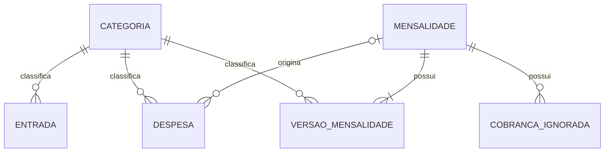

# Plataforma de Gestão Financeira Pessoal

## Objetivo e contexto

Plataforma para uso pessoal que centraliza a gestão financeira, começando pelo controle mensal de entradas, mensalidades e despesas.

Destinado ao usuário que realiza o controle manualmente, com anotações, papel e calculadora das suas finanças. A primeira versão será utilizada apenas de forma local no computador do usuário e isolada. Tem como objetivo o usuário conseguir registrar entradas e gastos/despesas categoricamente, assim o programa consegue entregar uma análise geral com dashboard´s para que o usuário consiga visualizar e administrar melhor suas finanças pessoais.

Essa é a primeira versão (MVP) do programa, logo apresenta apenas funcionalidades básicas de controle/gestão financeira. Novas funcionalidades, gráficos e informações de análise/indicadores serão adicionadas ao longo do tempo em versões futuras. 

## Stack tecnológica

| Parte | Tecnologia | Responsabilidade |
|---|---|---|
| Linguagem | Python | Regras financeiras e cálculos. |
| Framework web | Django | Cadastros, validações, recorrências e dashboard. |
| Banco de dados | PostgreSQL | Entradas, despesas e histórico. |
| Interface | Templates do Django + HTML + CSS + Bootstrap | Telas responsivas, formulários e tabelas. |
| Interatividade e gráficos | JavaScript + Chart.js | Interações da interface e gráficos a definir na etapa de front-end. |
| Controle de versões | Git + repositório privado no GitHub | Histórico e armazenamento do código. |
| Testes | Ferramentas de teste do Django | Verificação de cálculos, recorrências e operações dos registros. 

## Operações básicas

Entradas e gastos, incluindo despesas comuns e mensalidades, permitem:

- Adicionar/criar.
- Visualizar/listar.
- Editar.
- Excluir/deletar e cancelar.

Mensalidades também permitem cancelamento, com preservação do histórico.

## Entradas

Registrar apenas dinheiro efetivamente recebido, sem previsão de receitas.

Campos:

- Valor.
- Data do recebimento.
- Categoria.

Não tem nome nem descrição.

Categorias:

- Salário.
- Comissão.
- Outras receitas.

## Cadastro de despesas

Na interface tem um único cadastro de despesas, com escolha entre despesa comum e mensalidade. Os campos apresentados dependem do tipo selecionado.

### Despesa comum

Campos:

- Nome.
- Valor.
- Data.
- Forma de pagamento.
- Categoria.

Cada despesa comum é um lançamento individual, sem recorrência automática (não é mensalidade).

### Mensalidade

Campos:

- Nome.
- Valor mensal.
- Data da primeira cobrança.
- Duração em quantidade de meses.
- Categoria.
- Forma de pagamento.

Sem duração informada, a mensalidade fica definida como "continua até cancelar".

A data da primeira cobrança vem preenchida com a data atual e pode ser ajustada para registrar uma assinatura realizada anteriormente.

O dia recorrente é derivado automaticamente da data da primeira cobrança. Não haverá campo separado para o usuário preencher o dia.

### Categorias de despesas e mensalidades

- Transporte.
- Saúde.
- Educação.
- Lazer.
- Compras.
- Outros.

As categorias são predefinidas.

### Formas de pagamento

- Débito.
- Crédito.
- À vista/Pix.

Não há seleção ou identificação de cartões específicos nesta versão.

## Modelo de domínio

| Entidade | Responsabilidade |
|---|---|
| Categoria | Classificar entradas e despesas. |
| Entrada | Representar dinheiro efetivamente recebido. |
| Mensalidade | Identificar uma assinatura ou compromisso recorrente e controlar seu início e cancelamento. |
| Versão da mensalidade | Preservar as condições de uma mensalidade ao longo do tempo. |
| Despesa | Representar uma despesa comum ou uma cobrança individual de mensalidade. |
| Cobrança ignorada | Impedir a recriação de uma cobrança individual excluída. |

Cada cobrança de mensalidade é uma despesa, mas nem toda despesa vem de uma mensalidade.

Dashboard e extrato são consultas e calculados sobre esses registros, não entidades adicionais para armazenar cópias dos totais.

### Banco de dados

O banco terá seis tabelas, usando a estrutura escolhida: os dados da mensalidade ficam nas versões, sem duplicação do cadastro atual.

#### 1. `categorias`

| Coluna | Tipo | Finalidade |
|---|---|---|
| `id` | Identificador | Chave primária. |
| `nome` | Texto | Nome da categoria. |
| `aplicacao` | Texto controlado | Entrada ou despesa. |

#### 2. `entradas`

| Coluna | Tipo | Finalidade |
|---|---|---|
| `id` | Identificador | Chave primária. |
| `valor` | Decimal | Valor recebido. |
| `data_recebimento` | Data | Quando o dinheiro entrou. |
| `categoria_id` | Referência | Categoria de entrada. |
| `criado_em` | Data e hora | Preenchimento automático. |
| `atualizado_em` | Data e hora | Preenchimento automático. |

Sem nome ou descrição.

#### 3. `mensalidades`

Identifica a assinatura e controla sua existência. Os demais dados são obtidos das versões.

| Coluna | Tipo | Finalidade |
|---|---|---|
| `id` | Identificador | Chave primária. |
| `data_primeira_cobranca` | Data | Início da recorrência e origem do dia de cobrança. |
| `cancelada_em` | Data opcional | Vazia enquanto não houver cancelamento. |
| `criado_em` | Data e hora | Preenchimento automático. |

#### 4. `mensalidade_versoes`

| Coluna | Tipo | Finalidade |
|---|---|---|
| `id` | Identificador | Chave primária da versão. |
| `mensalidade_id` | Referência | Mensalidade à qual pertence. |
| `nome` | Texto | Nome da mensalidade. |
| `valor_mensal` | Decimal | Valor de cada cobrança. |
| `duracao_meses` | Inteiro opcional | Quantidade total de meses; vazio significa até cancelar. |
| `categoria_id` | Referência | Categoria de despesa. |
| `forma_pagamento` | Texto controlado | Débito, crédito ou à vista/Pix. |
| `vigente_desde` | Data e hora | Início de validade dessa versão. |

#### 5. `despesas`

| Coluna | Tipo | Finalidade |
|---|---|---|
| `id` | Identificador | Chave primária. |
| `nome` | Texto | Nome da despesa. |
| `valor` | Decimal | Valor do gasto. |
| `data` | Data | Data da despesa ou cobrança. |
| `forma_pagamento` | Texto controlado | Débito, crédito ou à vista/Pix. |
| `categoria_id` | Referência | Categoria de despesa. |
| `mensalidade_id` | Referência opcional | Mensalidade de origem, quando houver. |
| `criado_em` | Data e hora | Preenchimento automático. |
| `atualizado_em` | Data e hora | Preenchimento automático. |

- `mensalidade_id` vazio: despesa comum.
- `mensalidade_id` preenchido: cobrança de mensalidade.
- O mês dos cálculos vem de `data`. Não haverá coluna `mes_referencia` em despesas.

#### 6. `cobrancas_ignoradas`

| Coluna | Tipo | Finalidade |
|---|---|---|
| `id` | Identificador | Chave primária. |
| `mensalidade_id` | Referência | Mensalidade correspondente. |
| `ano` | Inteiro | Ano da cobrança excluída. |
| `mes` | Inteiro | Mês da cobrança excluída. |

Essa tabela não guarda o conteúdo da despesa apagada, apenas a indicação para não gerar novamente aquele mês.

#### Regras de integridade

- Valores monetários em reais, com `NUMERIC(14,2)`, maiores que zero.
- Duração: número inteiro positivo ou vazio.
- Uma cobrança por mensalidade em cada mês, sem duplicação.
- Uma indicação de cobrança ignorada por mensalidade, ano e mês.
- Nome de categoria sem repetição dentro da mesma aplicação.
- Categorias utilizadas não podem ser apagadas enquanto houver registros vinculados.
- Categorias de entrada são utilizadas nas entradas; categorias de despesa nas despesas e versões de mensalidade.
- Excluir uma mensalidade apaga também suas versões, despesas vinculadas e cobranças ignoradas.
- Cancelar mantém o histórico.
- A geração retroativa considera a versão válida em cada período.

### Relações entre as entidades

| Relação | Funcionamento |
|---|---|
| Categoria → Entradas | Uma categoria classifica várias entradas. Cada entrada tem uma categoria. |
| Categoria → Despesas | Uma categoria classifica várias despesas. Cada despesa tem uma categoria. |
| Categoria → Versões de mensalidade | Uma categoria pode ser usada em várias versões. Cada versão tem uma categoria. |
| Mensalidade → Versões | Uma mensalidade possui uma ou mais versões. Cada versão pertence a uma única mensalidade. |
| Mensalidade → Despesas | Uma mensalidade gera várias cobranças. Cada despesa pode pertencer a uma mensalidade ou ser comum, sem vínculo. |
| Mensalidade → Cobranças ignoradas | Uma mensalidade pode ter vários meses ignorados por exclusão de cobranças individuais. |

Entradas não possuem vínculo direto com despesas. Elas se encontram nos cálculos por período.

#### Exemplo das relações

Uma mensalidade da faculdade possui versões com os valores válidos em cada período e gera uma despesa por mês, vinculada à mesma mensalidade.

Cada despesa guarda o valor, a categoria e a forma de pagamento daquela cobrança. Se uma cobrança for excluída individualmente, fica um controle para não recriá-la.

Uma compra comum é uma despesa com categoria e forma de pagamento, sem vínculo com mensalidade.

## Regras de recorrência e histórico

### Geração das cobranças

- As cobranças começam na data da primeira cobrança informada.
- Datas passadas permitem a geração das cobranças desde aquele início.
- As cobranças seguintes acontecem mensalmente no dia derivado da primeira cobrança.
- Se o dia não existir no mês, será utilizado o último dia daquele mês, preservando o dia original para os meses seguintes.
- Uma mensalidade com duração definida gera a quantidade correspondente de cobranças mensais.
- A duração é contada desde a primeira cobrança; editar não reinicia automaticamente essa contagem.
- Uma mensalidade sem duração continua até cancelar.
- Cada mensalidade gera no máximo uma despesa por mês.
- Os gastos fixos previstos aparecem no mês desde o dia 1, mantendo a data da cobrança. Isso não representa confirmação de pagamento.
- Ao reabrir o programa, cobranças ausentes dos meses transcorridos são geradas sem duplicação.
- A geração retroativa considera as condições válidas em cada período.

### Edição e versões

- A alteração de uma mensalidade vale a partir da edição.
- O histórico anterior permanece como estava.
- Cadastrar cria a primeira versão da mensalidade.
- Editar acrescenta uma nova versão vinculada à mesma mensalidade.
- As versões anteriores permanecem guardadas.
- Para exibir o cadastro atual, o sistema consulta a versão mais recente.
- Cada cobrança guarda seus próprios dados, sem ser reescrita por uma alteração posterior da mensalidade.
- Correções de despesas antigas são feitas diretamente nos respectivos lançamentos.

Foi escolhida a estrutura em que os dados da mensalidade ficam nas versões, sem duplicar os campos atuais na tabela de mensalidades.

### Cancelamento

- Cancelar encerra a recorrência e preserva o histórico.
- Cobranças anteriores à data de cancelamento permanecem.
- Cobranças do dia do cancelamento em diante são interrompidas.

### Exclusão

- Excluir apaga o registro escolhido.
- Excluir uma mensalidade apaga o cadastro, suas versões, despesas vinculadas e controles de cobranças ignoradas.
- Excluir uma cobrança individual sem excluir a mensalidade gera um controle para impedir sua recriação automática.

## Evoluções futuras

- Acesso pelo celular.
- Gerenciamento de cartões e dívidas.
- Possibilidade de hospedagem, com revisão de segurança e acesso (possibilita acesso por outros dispositivos, ex.: celular)
- Gerenciamento de investimentos integrado à mesma plataforma.
- Novas funcionalidades e indicadores conforme a experiência de uso.

